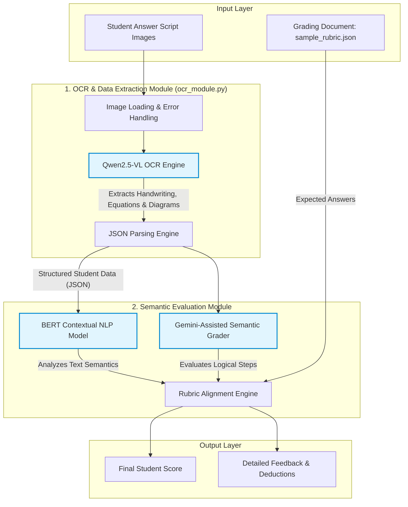

# Automated Answer Script Grading - System Architecture

This document provides a high-level overview of the Automated Answer Script Grading project, designed to evaluate student answer sheets automatically against provided rubrics and key answers using generative AI and NLP models.

## High-Level Workflow

## System Components

### 1. The Input Layer
- **Student Answer Scripts**: Scanned images or PDFs of the student's handwritten exam.
- **Rubrics & Key Answers**: Structured JSON configurations (like `sample_rubric.json`) that dictate the maximum marks per question, the expected answers, and the step-by-step marking logic.

### 2. OCR & Data Extraction Module
- Powered by the **Qwen2.5-VL** Vision Model (`ocr_module.py`), configurable for Dashscope API or Localhost deployment.
- Capable of reading complex handwritten text, translating equations into standard Standard LaTeX, and meticulously describing student-drawn diagrams. 
- Designed with built-in auto-retry logic to handle occasional server spikes (503 High Demand).
- Outputs exactly formatted JSON dictionaries mapping question numbers to the student's exact responses for easy downstream integration.

### 3. Semantic Evaluation Module
- Employs a dual-AI approach to grade the extracted text:
  - **Language Models (BERT/Transformers)**: Used to analyze the contextual similarity between the student's unstructured handwritten answer and the "key answer". 
  - **Generative AI (Gemini)**: Serves as the primary logic engine to determine if the student hit all the necessary semantic points outlined in the rubric (even if paraphrased).
- Accurately decides if partial credit should be awarded based on intermediate steps.

### 4. Output Layer
The architecture ultimately distills the AI evaluations into a readable format for instructors and students, providing transparent step-by-step point deductions, final scores, and actionable feedback.
